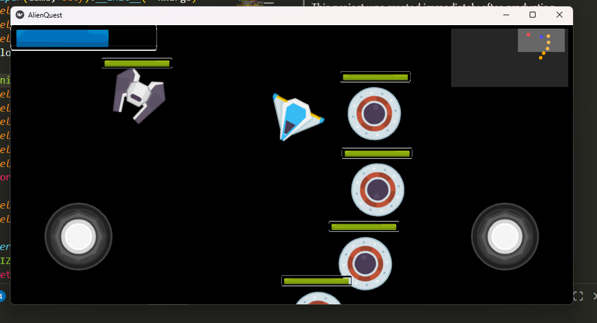

# Alien Quest

Alien Quest is a 2D space shooter game built with Python and Kivy.

This project was created immediately after graduating high school as a personal challenge to build a game engine from the ground up. Instead of relying on pre-built physics or high-level game engine features, I implemented the core physics, collision detection, and rendering logic myself to deeply understand the fundamentals of game development.

## Demo


[watch here](https://www.youtube.com/watch?v=A_ya9EiYzsk)


## Project Overview

The game features a player-controlled spaceship navigating a limitless scrolling map, fighting off various types of alien enemies. It demonstrates custom implementations of several core game development concepts.

### Key Features

*   **Custom Physics Engine:**
    *   Implemented manual physics calculations and vector mechanics.
    *   Custom circular collision detection algorithms.
    *   Entity separation logic to handle overlapping sprites physically.
*   **Custom Rendering System:**
    *   Built on top of Kivy's low-level graphics instructions (`Quad`, `Rectangle`).
    *   Manages sprite states, texture rotation, and sprite-sheet animations manually within the game loop.
*   **Enemy AI Behaviors:**
    *   Utilizes the **Strategy Pattern** (in `behaviors.py`) to define distinct movement behaviors for UFOs.
    *   Behaviors include tracking the player, circling, diagonal movement, and random evasion.
*   **Dual Joystick Control:** Custom virtual joystick implementation for independent movement and aiming/firing mechanics.
*   **Game Mechanics:**
    *   Scrolling camera system that tracks the player.
    *   Real-time mini-map (radar).
    *   Health systems, shields, and weapon cooldowns.

## Technical Details

*   **Language:** Python
*   **Framework:** Kivy (Used primarily for window management and canvas drawing primitives).
*   **Architecture:**
    *   `main.py`: The main game loop, state management, and scene composition.
    *   `sprite.py`: The core engine class handling geometry, texture mapping, and physics updates.
    *   `behaviors.py`: Modular AI behaviors for enemies.
    *   `utils.py`: Math utilities (trigonometry for vector movement/rotation) and UI components.

## How to Run

1.  Ensure you have Python installed.
2.  Install the required dependencies:
    ```bash
    pip install kivy pillow plyer
    ```
3.  Run the game:
    ```bash
    python main.py
    ```